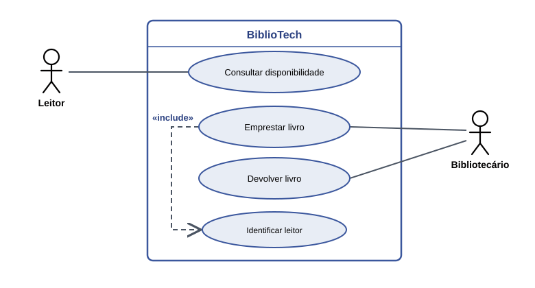
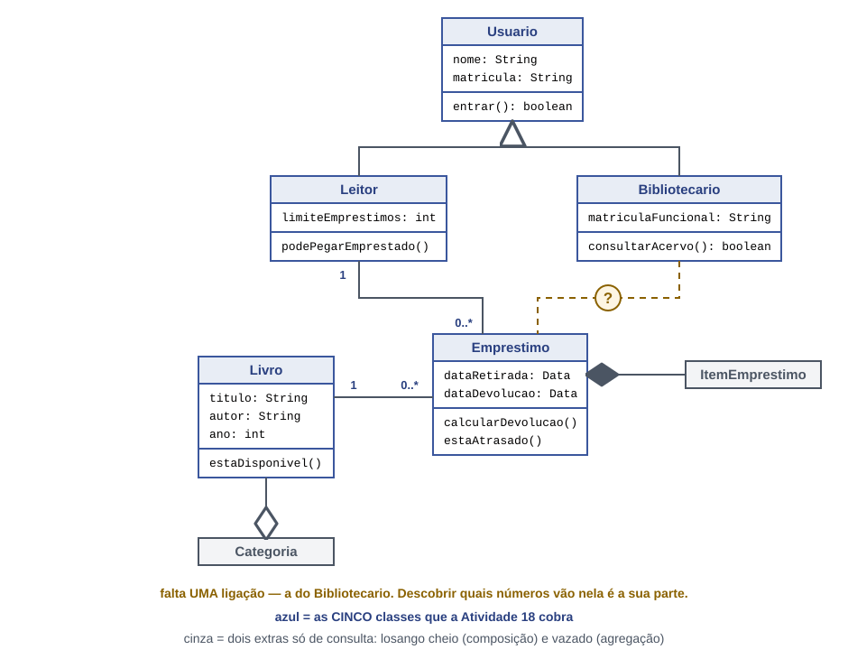

# BiblioTech
​
Sistema de emprestimo de livros para a biblioteca do campus.
​
## 1. O projeto
​
O cliente é os alunos e professores que precisam usar o sistema para emprestar livros. O problema principal é o processo de emprestar livros e o sistema simplifica e facilita esse processo

## 2. Historias de usuario
​
| # | Historia de usuario |
|---|---|
| HU01 | Como leitor, quero consultar a disponibilidade de um livro, para saber se posso pega-lo emprestado sem ir ate o balcao. |
| HU02 | Como leitor, quero devolver um livro, para nao ficar com pendencia na biblioteca. |
| HU03 | Como bibliotecaria, quero registrar um emprestimo, para saber quem esta com cada exemplar. |
| HU04 | Como bibliotecaria, quero cadastrar um livro novo, para que ele possa ser encontrado no sistema. |
| HU05 | Como bibliotecaria, quero ver os emprestimos atrasados, para cobrar a devolucao. |

## 3. Requisitos
​
### Requisitos funcionais
​
| # | Requisito funcional | Veio da |
|---|---|---|
| RF01 | O sistema deve permitir que a bibliotecaria cadastre um livro no acervo. | HU04 |
| RF02 | O sistema deve permitir que a bibliotecaria cadastre um leitor. | regra de acesso: so quem tem cadastro leva livro |
| RF03 | O sistema deve permitir que o leitor consulte a disponibilidade de um livro. | HU01 |
| RF04 | O sistema deve permitir que a bibliotecaria registre a devolucao de um livro. | HU02 |
| RF05 | O sistema deve permitir que a bibliotecaria registre o emprestimo de um livro. | HU03 |
| RF06 | (o seu: escreva aqui) | (de onde veio) |
​
### Requisitos nao funcionais
​
| # | Requisito nao funcional |
|---|---|
| RNF01 | A consulta de disponibilidade deve responder em menos de 3 segundos. |
| RNF02 | Somente usuarios identificados como bibliotecarios podem alterar o acervo. |

## 4. Diagramas (feitos em APS)
​
### Casos de uso
​

​
### Classes
​

## 6. Como Executar

no Codespace, dentro da pasta `bibliotech`:

'''
javac *.java
java TesteRequisitos
java TelaBiblioteca
'''

`TesteRequisitos` confere os requisitos no terminal. `TelaBiblioteca` abre a janela na área de trabalho do Codespace (porta 6080).

## 7. Requisitos e verificações

| # | Onde está no código | Como verifico |
|---|---|---|
| RF01 | `Biblioteca.cadastrarLivro()` | TesteRequisitos: 1 verificação RF01 |
| RF02 | `Biblioteca.cadastrarLeitor()` | TesteRequisitos: 1 verificação RF02 |
| RF03 | `Biblioteca.buscarLivro()` e `Livro.estaDisponivel()` | área do acervo na janela \| TesteRequisitos: 2 verificações RF03 |
| RF04 | `Biblioteca.devolver()`, que chama `Emprestimo.registrarDevolucao()` | botão Devolver \| TesteRequisitos: 3 verificações RF04 |
| RF05 | `Biblioteca.emprestar()`, que chama `Emprestimo.realizarEmprestimo()` | botão Emprestar \| TesteRequisitos: 5 verificações RF05 |
| RF06 | (o seu RF: onde está, ou "ainda não implementado") | (a verificação, ou "sem verificação") |

## 8. O que o BiblioTech ainda não faz

- HUBS: ver os empréstimos atrasados. O empréstimo ainda não tem prazo.
- RNF02: qualquer pessoa que abre a janela pode emprestar e devolver; não há login de bibliotecário.
- Cadastrar livro e leitor pela janela: hoje o cadastro está no `main` de `TelaBiblioteca`.
- Guardar os dados: ao fechar o programa, os empréstimos se perdem.